# 战斗机介绍

小球对战里可选的对战单位。吃伤害、计入胜负。按选人页顺序，和 `character/all.go` 的 import 顺序一致。不写胜率。

五维都是 1–5，3 是这批里的中等。源码里没有这些分数。下面只保留原先写过的；新补的节不打分。

- **生存**：作为战斗机留在场上。血量、减伤、闪避、回血、壳；拖到超时也算。
- **爆发**：短时间窗口内的造伤。击破伤害算入爆发。
- **稳定**：打法不靠运气、不靠特定窗口。不是巡航。
- **机动**：自己改位置。拉、推、墙、眩晕动的是别人，不抬自己的机动。
- **输出**：整场持续造伤。同一记可以同时算入输出和爆发。

- [弓箭](#弓箭)
- [盾斧](#盾斧)
- [血契](#血契)
- [炭翁](#炭翁)
- [分身者](#分身者)
- [分身者(百战)](#分身者百战)
- [靶子](#靶子)
- [回声](#回声)
- [内燃机](#内燃机)
- [钓鱼佬](#钓鱼佬)
- [地慧星](#地慧星)
- [教父](#教父)
- [教父(青年)](#教父青年)
- [反重力猫咪](#反重力猫咪)
- [钉与锤](#钉与锤)
- [勇者](#勇者)
- [原型机_整合](#原型机_整合)
- [小骑士](#小骑士)
- [蛆](#蛆)
- [迷走](#迷走)
- [原型机_近战](#原型机_近战)
- [面灵气](#面灵气)
- [我与周旋久](#我与周旋久)
- [大肥鱼](#大肥鱼)
- [老牧师](#老牧师)
- [巡回](#巡回)
- [吹笛人](#吹笛人)
- [囚徒](#囚徒)
- [雷达](#雷达)
- [雷达(百战)](#雷达百战)
- [原型机_远程](#原型机_远程)
- [收割者](#收割者)
- [中转站](#中转站)
- [R.缪](#r缪)
- [酒翁](#酒翁)
- [静电魔球](#静电魔球)
- [太刀](#太刀)
- [谭泳辰老先生](#谭泳辰老先生)
- [时计](#时计)
- [无下限术士](#无下限术士)
- [人偶使](#人偶使)
- [筑墙者](#筑墙者)
- [筑墙者(百战)](#筑墙者百战)
- [盾士](#盾士)
- [狼人](#狼人)

## 弓箭

观众能看见：深褐圆球。箭是浅色的，不拖引擎那条尾。

不靠资源。蓄力站定再射，后撤步边撤边射，远处齐射四支并排，挨打可以翻滚挡下这一下。每支箭伤 5，中箭的人愣 0.2 秒。

## 盾斧

观众能看见：灰色圆球。

正面用盾减伤。摸到人就切剑，斩击攒能量，灌瓶之后转红。红斧巡航降到 90，再走解放。

## 血契

观众能看见：暗红圆球。身前一道薄扇环。有血线时线从细变粗。

饿扑、收线、召血蝠都烧自己的血。咬合免费，够到的敌方战斗机或敌方活随从当拍连上血线。收线时自己站定，把线上的人拽过来。血太低就不再烧血。

## 炭翁

观众能看见：戴斗笠的冷灰窑身，窑口有火；炭是一颗颗橙块，绕在持有者身边，伤害越高越大，快到期发白。交接时一块炭从炭翁飞到对方身上。

视野 150。有索敌目标就转向，没有就不改方向。球自己不出伤。打在身上的伤害先走无效、闪避、减伤，剩下的结成炭，那一下不扣血也不停帧。每 2.5 秒自己结一颗面值 6 的炭，开局先等满一次。每颗 12 秒到期，最后 0.4 秒发白。同一拍先到期，再入账，再交接；入账含这一拍打进来的伤害和到点的自结。每个单位最多持有 6 颗；已经有 6 颗时再受到一颗，原先最老的立刻到期，新的留下。索到谁就交一颗，先交最快到期的；交出后 1.2 秒才能再交，人一直被索着也按这个间隔。离开视野则停。到期是炭翁打在持有者身上的一记，只扣持有者。扣在敌人战斗机上停一次帧，烧自己或扣在活随从上不停帧。无下限术士开局第一拍本体仍可瞄准且在视野里，炭交给本体；之后交给被索到的红半或蓝半。

生存 3 · 爆发 4 · 稳定 2 · 机动 4 · 输出 2

## 分身者

观众能看见：灰蓝实心圆。本体和三颗分身一个颜色。

本体不出伤。开局身边三颗分身，各挂一圈细环刮人。挨打且未死时，和随机分身换位置。

生存 4 · 爆发 2 · 稳定 5 · 机动 3 · 输出 5

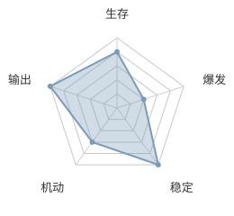

## 分身者(百战)

观众能看见：场上不画本体。四只铁青战影，头顶各自的血。

生命在本体上。开局四只战影，不补。战影按抽到的招一起走。一只战影倒下，本体吃一次折损，剩下的战影回一点血。

## 靶子

观众能看见：蓝色圆球，头顶一只一直说话的伤害气泡。气泡大字是全程 DPS（累计吃到的伤害 ÷ 开局至今），小字是近 5 秒 DPS 和累计伤害。一枪没打也照报 0.0，每 0.2 秒换一次字。

开局血量 99999。挨打照单全收。不出伤，不转向，不改巡航。用来看别的球打得怎样。

## 回声

观众能看见：靛蓝圆球，正面一道闭着的声呐眼；金色星弹从移动方向飞出，撞到墙、人或弹就炸成一圈 16 枚青色声呐碎片；碎片在墙上弹几次才消失。被碎片打中的敌人身上会起一圈青色扫描环，每中一枚补一层，每层 10 秒后自己掉；满 10 层后环变白、回声睁眼，从扫描换成固定 6 秒的突进窗口。期间环保持全满、不再补层或逐层衰减，到期一起清零，再重新积累。层数不显示在通用状态栏，只看这圈环。

声呐读全场，但只把扫满 10 层的敌人当目标。平时朝自己移动的方向放星弹（星弹和碎片完全不出伤，只补扫描）；一旦场上有目标满 10 层，回声不再发星弹，改成穿人冲墙（狼人式，但不限次数）：先站定 0.08 秒锁人，再穿人朝锁定方向直冲到墙，撞到目标就 6 伤；撞墙后重新锁；不挂常驻弧；六秒结束时清空标记、退出并把速度重置回巡航，目标没了也退出。

## 内燃机

观众能看见：边缘铁色、中心高温，档位越高中心越向外扩；6 档全烧红。球外一圈细槽是热力条。虚弱时整球变暗、停住。

热力条按时间自涨，满了升档，6 档满则击破。升档只改巡航和视野。普通攻击是自己的节拍；击破后站两秒，第 1 秒打击破伤害。造成的伤害不停帧。

生存 2 · 爆发 4 · 稳定 3 · 机动 3 · 输出 3

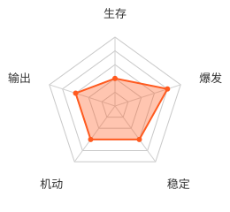

## 钓鱼佬

观众能看见：金黄圆，带暖色光。空军后光偏蓝；高速碰撞时更亮、更饱和。

不转向。开局在可进入区域随机铺三口鱼塘，踩进去站住才钓。空军加快走路巡航。第二次空军清掉还在的开局塘，铺一口盖满场地的鱼塘，之后飞着钓。够重的鱼先扛着跑，到点再甩出。

生存 3 · 爆发 4 · 稳定 1 · 机动 4 · 输出 3

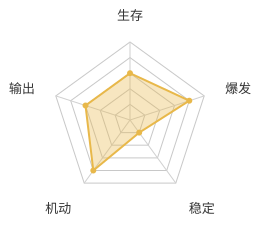

## 地慧星

观众能看见：天蓝色球，常驻故障切片。居合时球体带短刀光。

身前窄扇环叠剑痕，偶尔留下可穿过的故障残影。受击时若闪避就绪，无效该次攻击并瞬移到离敌人最远的角。撞场边会叠速度。稍后锁定蓄力，打出一条极宽的无限长斩击。

生存 4 · 爆发 5 · 稳定 2 · 机动 4 · 输出 4

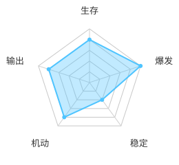

## 教父

观众能看见：深色圆球，细金边。

不转向，自己不出伤。从场边冒出活随从，种类不重复。暗杀者冲刺，狙击者瞄准后开枪，贩卖者丢药然后退场。

## 教父(青年)

观众能看见：比教父浅一号的黑圆，细金边，边上多一圈暗红。球旁是针剂格。

身上三枚针剂，只减不补。近了撞击，远了打手枪。花掉针剂就强化一段时间：巡航变快，手枪变多，撞击能把人晕住再折返。

## 反重力猫咪

观众能看见：蓝紫渐变圆球，左上高光、右下青、右上粉，头顶两只猫耳，带辉光。反重力弹是四色四角星，自转。重力脉冲是一大圈旋转的双层环，开时原地炸一把星。

不索敌，不瞄人，自己不出伤；沿场心轨道飞。顺轨道打弹，弹的切向速度故意给少，往场心螺旋掉下去，碰到场心消失；打中按当时的速率算伤，1 到 8，越快越疼。每 20 秒在当前位置开一次重力脉冲，3 秒，半径 420；开了就不跟猫走。圈里自己的弹被收进绕身轨道，到点甩出去，越靠外甩得越快；圈里敌方子弹被抢成自己的弹；别的飞弹和分身被随机拨一个方向，速度不变。猫每拍顺飞行方向补一点速度，轨道不设上限；比当地逃逸还快就不再补。

## 钉与锤

观众能看见：紫色圆球，身外有视野圈。

近战用锤。钉子打中会定人，层数够了爆开。人偶替身把打在它身上的伤转走。

## 勇者

观众能看见：金色圆球。捡到剑之后，球上挂着一把跟着面朝转的剑。

开局不去找装备，四件遗物靠撞上才收。剑是近战，三位同伴跟在后面。史莱姆只咬勇者这一边。杀掉活随从升级，上限和攻击一起涨。

## 原型机_整合

观众能看见：球心青蓝，外圈橙。近处一圈橙色刻度，更近一圈青色刻度。不画视野圈。

有目标才射击，方向在指向目标的左右各 60° 里摇。人从外圈跨进来可以上追踪。人从内圈外跨进来，自己朝离开的方向加速。

## 小骑士

观众能看见：鲜红实心圆，冲起来会留残影。6 秒那档身外有一圈细火环，火往上飘，从空长到满；0.5 秒连冲不画。

开局不满血。身前宽扇环一直挂着。每隔一段时间瞬移到敌人身边再冲撞，有时会立刻再来一次。第一次要死的时候拦下来，锁血十秒。

生存 2 · 爆发 5 · 稳定 4 · 机动 5 · 输出 4

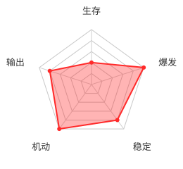

## 蛆

观众能看见：本体不画；粉白蠕虫形蛆宝宝（沿速度蠕动）、头胸腹振翅的苍蝇（白眼可繁殖、红眼冷却）、半透明灰绿卵；三段活随从头顶有生命数字。

本体不出现，生命在本体上，活随从不转伤。开局五只宝宝，成长为苍蝇后互吸叠卵再孵化，苍蝇数量光环磨血。场上无活随从 3 秒则本体扣光。

生存 2 · 爆发 1 · 稳定 2 · 机动 2 · 输出 4

## 迷走

观众能看见：2D 平涂冷青灰圆球；场上六条淡青细环（球下方、场地裁切；外五条锚点沿引导圆转，引导圆跟着心环的圆心，圆心再小抖；整张图随中点平移）；当前所在那条更深青亮盘（环内也铺色）。

不索敌。开局铺心环+轨环；中点以 150 巡游（没有碰撞体，只在场边内缩域里弹），迷走撞墙把中点速度按法线弹回去（0.5 秒一次）；轨环锚点沿看不见的引导圆转，六条圆心相对锚点栓绳抖；人只沿环线切向走并骑轨跟漂；交点按现几何、随机改道（不回头）；环上撞墙反绕。点亮亮盘（环上+环内）刮伤 3（0.4s）敌方战斗机与活随从。球自己不出伤。

生存 3 · 爆发 1 · 稳定 2 · 机动 4 · 输出 3

## 原型机_近战

观众能看见：青绿实心圆，带视野圈；超速时留冲刺残影。扇环张角会随减伤变宽。

敌人进入视野边沿就朝对方偏一点，并加速顶上去。身前扇环刮人。挨打时若比巡航快，按超出的速度减伤。

生存 3 · 爆发 2 · 稳定 2 · 机动 5 · 输出 3

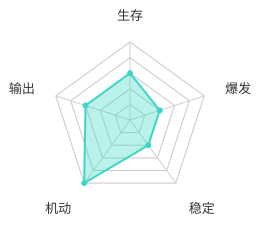

## 面灵气

观众能看见：球色自己在青、红、紫、苍之间转，不改别人颜色。槽位上挂派系图标。身周三张面具顺时针转，图像不跟着转。勾数画在球下方。

开局给自己和敌方每只战斗机各打一个派系。1 勾时异派系加伤、同派系减伤。10 秒后 2 勾，撞墙换派系；敌方每只战斗机各自在补上第四种的那一瞬按这一种结算。再 20 秒 3 勾，倍率加大，凑齐后重新累计。当前派系决定面具伤/体积、射弹、加速或消弹回血。

生存 2 · 爆发 3 · 稳定 2 · 机动 4 · 输出 3

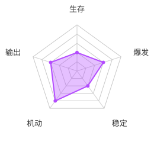

## 我与周旋久

观众能看见：紫色圆球，旁边一只同色的周旋久。

还在无事发生时，和周旋久相撞会互相掉血，并掷出误认、失败或仍是无事发生。周旋久先倒下，或自己挨到致命伤，会按当时的状态变成虚空、神圣、自杀或怪物。胜负仍看这只战斗机。

## 大肥鱼

观众能看见：深蓝圆球，贴着原身立绘，脸朝观众。白饭从七张图里随机抽一张。虎鲸是矢量侧影；潜水时沉下去、变淡，跃起时换成跳跃图，原地闪一下；入水炸两圈水花。

原身不索敌，不转向，不朝白饭走，自己不出伤。白饭撒在可进入区域里，最多五碗，不足每 3 秒补一碗，不撒在她身上；碗不吃伤害，只有原身的圆压得上才吃得掉。原身连续 7 秒没吃上就停在开口那一点喊饭，直到吃上：每 0.5 秒飘一次白色粗体「饭来！」，最近的一碗朝她正弦冲 60、0.4 秒，可以穿墙。吃完回 5 点生命。吃到就变虎鲸 6 秒：半径 34，挨打减半，这几秒不吃白饭。先潜 0.45 秒，再朝跃起那一瞬最近的敌人跃过去，最多 0.5 秒、最远 320，落点钉死在这段距离里，够不着也不闪过去；人走开就打不到；入水时半径 72.8 里敌方战斗机和活随从各吃 9，打中战斗机停一次帧。出水后沿跃的方向滑 1.1 秒，还有时间就再潜一次。6 秒到点变回原身；倒下时剩下的碗一起收掉。

## 老牧师

观众能看见：白圆球，脸正对观众。平时是闭嘴的笑脸，惨叫时换成张嘴。身外最多三圈汉字，各自顺时针转。每一圈出现时在 1.5 到 2.5 秒一圈里抽一次，抽完不变。每个字的底部正对球。

不索敌，不转向，撞墙弹开。球自己不出伤。确认扣了生命才进入惨叫：换脸并出一声，和这一声一样长；这段里再扣血不重开。经文一次喊一句，开局哎呦我去，然后巴哈哈哈哈、我丢雷老某、呦吼吼吼吼。一句喊完，内圈顶到中圈，中圈顶到外圈，最外的消失。字心到圆心 46、78、110。每个字伤 2、判定半径 8，不实心。确认扣血后这个字消失并留空。造成的伤害不停帧。倒下那一拍先结算已经重叠上的字，再和三圈一起消失。

生存 3 · 爆发 2 · 稳定 4 · 机动 2 · 输出 2

## 巡回

观众能看见：钢蓝圆球，膛内一枚琥珀色菱形。标识物在外时本体降饱和、菱形变空心缓脉冲——停机等回收。标识物是自旋的琥珀色警标菱环，内芯箭头指向飞行方向，飞得越快转得越快、烧得越亮。

朝随机方向丢出标识物后自身停止移动。标识物一路加速、撞墙按入射角反弹，直到撞中敌方目标才折返；伤害随撞击时速水涨船高（8 起步、封顶 26），所以放它弹得越久砸得越疼。折返一路继续加速、撞谁谁掉血，回到巡回身边消失，巡回随即恢复巡航，5 秒后再丢。标识物在外期间巡回是站着不动的活靶，这是整套打法的代价。

## 吹笛人

观众能看见：紫色圆球。老鼠从球边跑出去。

自己不出伤。隔一段时间站定吹笛，放出老鼠，场上有上限。老鼠死亡，或贴在敌人身边够久，会叠瘟疫。瘟疫的跳血由吹笛人结算。

## 囚徒

观众能看见：圆球横向黑白条纹相间。钩爪钉上之后，两点之间是一节一节的锈铁链，松弛时挤在弦上，不垂下去弯。

不转向。开局没有钩爪，第一次撞场边才钉；砌在场上的墙不钉。锁链和球体都不出伤。按点落下囚笼、绞刑架、电椅。电流打中锁链则触电，巡航加倍。

生存 3 · 爆发 2 · 稳定 3 · 机动 4 · 输出 3

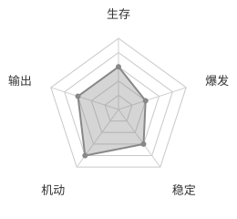

## 雷达

观众能看见：深绿磷光的圆球，不是碟。一条更亮的绿细线从球心伸出，顺时针转，墙处截断。

不转向，撞墙弹开。激光开局就有、一直转、不灭，碰到墙就截断。扫到敌方战斗机或敌方活随从就结算。朝向不跟速度绑。

生存 2 · 爆发 1 · 稳定 5 · 机动 2 · 输出 4

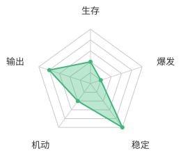

## 雷达(百战)

观众能看见：暗青绿圆球；球外一圈淡青潜水艇雷达标线（十字与同心圆相交）。淡青扫掠线在墙处截断；落弹影渐大，到点琥珀炸开。

不转向，撞墙弹开。没有点名时扫掠线本身不出伤，被墙裁断。点名线上最近的一个人后线消失，先用 1 秒让球壳裂开，再隔 1 秒打一轮，共四轮。打完再用 1 秒收回，扫掠线才回来。

生存 3 · 爆发 2 · 稳定 3 · 机动 2 · 输出 3

## 原型机_远程

观众能看见：暖橙实心圆。打出的弹是同色小火箭，尖头朝前，尾部两片小翼，后面一条尾焰，飞得越快焰越长。

看得见全场。有敌才射。子弹沿开枪方向越飞越快，撞墙弹开后从零再加速，第三次撞墙消失。每开一枪，自己速度反向。

生存 2 · 爆发 2 · 稳定 4 · 机动 3 · 输出 3

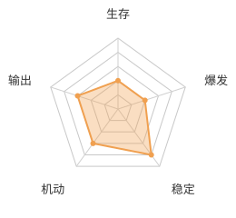

## 收割者

观众能看见：暗紫圆球。钉在场边上的是 2D 描边暗刃、刃口洋红的新月；出过伤之后整把变鲜红。

不转向。撞场边或硬墙钉镰刀，胶囊墙不钉。刀打中不消失。场上到 10 把，这一批放大飞回本体；出过伤的碰到自己回血。

生存 4 · 爆发 3 · 稳定 3 · 机动 2 · 输出 4

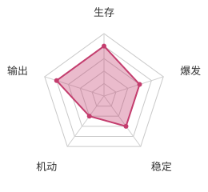

## 中转站

观众能看见：琥珀铜圆。随从是更小的暗铜圆。弹是细的亮琥珀，带拖尾。

不转向，自己不出伤。开局就留下随从，之后继续留。随从和本体把弹传来传去，打中人仍穿过去。

## R.缪

观众能看见：白圆，和放出去的缪一个样子。

开局放 5 只缪。本体和血最高的那只互换位置和血。缪用近战、子弹和突刺打人。

## 酒翁

观众能看见：沙色圆球。酒坛砸下来，碎处留下一摊酒。

自己不出伤。朝敌人头顶砸酒。酒碰到人、墙或子弹就碎。踩进酒场的人变慢。他自己的醉意用来决定下一轮砸几坛。

## 静电魔球

观众能看见：淡蓝电光圆球，带辉光。电荷越满球皮越亮，头顶数字角标是充能层数（满 10 层）；满电还没放时高频闪。放电时蓝色折线闪电肉眼可见地爬出去——一跳描完再起下一跳，出伤的命中点在电弧到达的瞬间炸出闪光和火花。

整个角色只做一件事：电人。摩擦起电：动着才生电，撞球、撞墙、挨打都充能，站定不充。电荷满 100 开链放电：闪电一跳一跳推进（每 0.25 秒一跳），最多命中敌人 4 跳，逐跳衰减（10→8→6→4）；每一跳都按当下位置重新选目标，优先弹射程内最近的敌方战斗机，没有才弹活随从，同槽友军永远不挨。单人局没有第二个目标可弹时，把自己当中继点（不出伤），四跳照样全落在唯一的对手身上。开链瞬间电荷清零；敌人中途跑出射程，链条就断在半路，充的电白费。满电但敌人在射程外时加速逼近。

## 太刀

观众能看见：浅色圆球，刃色画在球上。

不追人。人走进身前扇形就挥一刀，这刀不升刃色。每隔一段时间纳刀站定；窗口里挨打就拔刀斩，打中升刃色。挨打太密则后撤再回旋。红刃那一斩打中会登龙，结束落到黄刃。

## 谭泳辰老先生

观众能看见：青色圆球。场上有铃铛和苦无。

开局空手乱飞。自己或同边战斗机撞上铃铛、苦无才算捡到。有苦无才朝人丢苦无。有铃铛时命中够了会净化。命中或暴击够了会开灵狐场域，苦无丢得更快。

## 时计

观众能看见：白盘、黑针，开局 0:00。地上的时刻停在刻下时的读数。

每 8 秒时针走两小时。2 点到 12 点的偶数钟点各刻一次，刻过的不再刻。敌人踩进时刻，时计冲过去，并短时间挂上扇环。只有致命伤、而且还有时刻时，才整包拦下并回到上一档。

六个钟点全部刻过、最后一个时刻也用掉或被偷走后，时计进入三秒死亡演出：时针分针反向加速狂转，表盘抖动、泛起过热光晕，随后退场。演出期间不再战斗，暂停时演出也暂停。中途用光但仍有未刻钟点时，保留原来的空走机制。

## 无下限术士

观众能看见：红、蓝两个半圆，中间有连线。红侧像在吸，蓝侧像在推。开局三秒两球头顶交替跳出【九纲】【偏光】【乌与声明】【表里之间】。靠近互吸时场环变成多层收扩同心圆，连线换成多条扭动的紫曲线。相撞时打出的紫弹很大、带拖尾。

开局裂成两半：红吸引、蓝推开，两半身前都挂扇环。开局三秒内两半不会因靠近互吸；三秒后仅一次无视距离互相吸引并撞出紫弹。之后两半靠近时会互相吸引一次，吸完冷却一段时间。红蓝第一次碰到一起时从中点打一发紫弹，中间有挡视线的墙也打。之后再碰到要看得见敌人才打。紫弹穿透敌人可反复结算。

生存 3 · 爆发 4 · 稳定 3 · 机动 3 · 输出 4

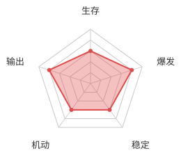

## 人偶使

观众能看见：金黄圆，带光。球外一圈细槽是灵力。人偶是更大的黄球，和本体有白线。

灵力会自己涨，放技能时涨不动。空灵力挨打更痛；前方命中可耗灵力减伤。手里随时准备符卡。人偶打完会收回，待命的人偶能追击或被激光串起来。

生存 3 · 爆发 4 · 稳定 3 · 机动 2 · 输出 4

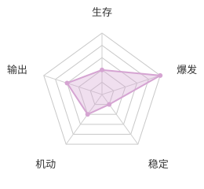

## 筑墙者

观众能看见：土黄实心圆。身前有一段瞄准虚线，和即将砌出的墙一样长。

按节拍在自己和敌人的中点砌胶囊墙。墙人人弹开，只刮敌方战斗机。自己不会瞬移、不会加速。

生存 4 · 爆发 1 · 稳定 4 · 机动 1 · 输出 2

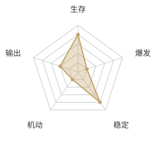

## 筑墙者(百战)

观众能看见：砖色圆球，带一点轻度裂纹。球不换样子。只有前墙、人还在动时，墙身后有很短很稀的砖尘。两堵墙对转时，各有一短截法线标，对准就亮住，先到的等着。冲撞时标收掉，砖尘顺着各自的反方向变密。相撞时大块砖沿冲撞方向向两侧飞开，相撞中心的砖色圆环闪一下。

不转向，球不出伤。先在身前砌前墙，再把第二堵砌在敌人后方。满两堵对转，然后沿法线冲撞。

生存 3 · 爆发 4 · 稳定 3 · 机动 1 · 输出 3

## 盾士

观众能看见：灰蓝实心圆，贴身一圈盾环。环碎时炸出碎片。

盾挡住伤害。盾碎或自己格挡时炸碎片。过一段时间，或累计挨打够了，再补盾。

生存 5 · 爆发 3 · 稳定 4 · 机动 2 · 输出 2

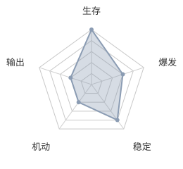

## 狼人

观众能看见：偏骨白的圆，带光。可进入区域里有一颗浅金月亮。撕咬时球更亮、更红。

开局在可进入区域随机挂月亮，不与墙重叠。自己、敌方战斗机或敌方活随从进入月亮，推进月相。满月进入撕咬：先站定锁敌，再连续冲墙。平时身前扇环；撕咬时换成更宽、更疼的撕咬弧。

生存 3 · 爆发 5 · 稳定 2 · 机动 5 · 输出 4

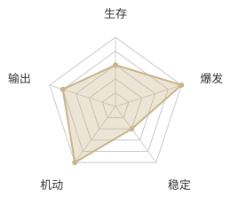
