# 战斗机介绍

小球对战里可选的对战单位。吃伤害、计入胜负。按选人页顺序，和 `character/all.go` 的 import 顺序一致。不写胜率。

场内生命统一用头顶白色整数显示，战斗机和活随从同款；四舍五入，存活时最低显示 1。隐藏本体仍隐藏，红蓝半显示所属主人生命，非因果影沿用影自己的生命来源；页面与视频的场外血条保留。

五维都是 1–5，3 是这批里的中等。源码里没有这些分数。下面只保留原先写过的；新补的节不打分。

- **生存**：作为战斗机留在场上。血量、减伤、闪避、回血、壳；拖到超时也算。
- **爆发**：短时间窗口内的造伤。击破伤害算入爆发。
- **稳定**：打法不靠运气、不靠特定窗口。不是巡航。
- **机动**：自己改位置。拉、推、墙、眩晕动的是别人，不抬自己的机动。
- **输出**：整场持续造伤。同一记可以同时算入输出和爆发。

- [弓箭](#弓箭)
- [盾斧](#盾斧)
- [血契](#血契)
- [捆](#捆)
- [炭翁](#炭翁)
- [凝聚体](#凝聚体)
- [分身者](#分身者)
- [分身者(百战)](#分身者百战)
- [靶子](#靶子)
- [回声](#回声)
- [内燃机](#内燃机)
- [钓鱼佬](#钓鱼佬)
- [藤姬](#藤姬)
- [地慧星](#地慧星)
- [教父](#教父)
- [教父(青年)](#教父青年)
- [反重力猫咪](#反重力猫咪)
- [钉与锤](#钉与锤)
- [勇者](#勇者)
- [原型机_整合](#原型机_整合)
- [小骑士](#小骑士)
- [蛆](#蛆)
- [迷走](#迷走)
- [原型机_近战](#原型机_近战)
- [面灵气](#面灵气)
- [我与周旋久](#我与周旋久)
- [观察者](#观察者)
- [大肥鱼](#大肥鱼)
- [老牧师](#老牧师)
- [巡回](#巡回)
- [吹笛人](#吹笛人)
- [囚徒](#囚徒)
- [雷达](#雷达)
- [雷达(百战)](#雷达百战)
- [原型机_远程](#原型机_远程)
- [收割者](#收割者)
- [中转站](#中转站)
- [中转站\[ospf\]](#中转站ospf)
- [R.缪](#r缪)
- [酒翁](#酒翁)
- [泡泡球](#泡泡球)
- [静电魔球](#静电魔球)
- [传票员](#传票员)
- [外科手术](#外科手术)
- [太刀](#太刀)
- [谭泳辰老先生](#谭泳辰老先生)
- [阈值](#阈值)
- [时计](#时计)
- [时计·铭刻](#时计铭刻)
- [无下限术士](#无下限术士)
- [人偶使](#人偶使)
- [筑墙者](#筑墙者)
- [筑墙者(百战)](#筑墙者百战)
- [盾士](#盾士)
- [狼人](#狼人)
- [小幺哥](#小幺哥)
- [闪烁](#闪烁)

## 弓箭

观众能看见：深褐圆球。箭是浅色的，不拖引擎那条尾。

不靠资源。蓄力站定再射，后撤步边撤边射，远处齐射四支并排，挨打可以翻滚挡下这一下。每支箭伤 4，中箭的人愣 0.2 秒；收弓要收满 0.35 秒才够再起手，站定时想撤也得付这一刻。

## 纵火者

观众能看见：焦黑硬壳、细裂口和球心明暗的橙红余烬。油瓶和火瓶是能看见高光、透明瓶颈与瓶内液体的玻璃瓶，火瓶的布芯带火。油是黑亮黏稠的连续焦油面，重叠处融成一摊；火舌和火星沿油推进，烧尽后露出地面，敌人身上也会带火。

自己不出伤。开局 0.6 秒后先扔油瓶，之后每 2.5 秒一瓶，三瓶油、一瓶火，直线飞向记下的敌人位置。墙或敌方身体把瓶子挡住就在那儿碎，没有冲击伤害。敌方站在油里或火里，移动速度都减少四成，两摊叠在一起不更慢，离开就恢复；自己和同边不减速。人走过油，离开后沿路再拖一段；自己的油不论何时铺下，相接就连通；自己的火只烧自己的油，从重合处以 80 往外烧，每块点燃的油燃烧 2 秒。着火的敌人碰到油，也会从碰上的地方把油点着。火上的敌人每 0.2 秒吃 1 点，离开后还会再烧一会儿。倒下时瓶子、油、火和燃烧一起消失。

生存 3 · 爆发 3 · 稳定 3 · 机动 2 · 输出 3

## 纵火者

观众能看见：焦黑硬壳、细裂口和球心明暗的橙红余烬。油瓶和火瓶是能看见高光、透明瓶颈与瓶内液体的玻璃瓶，火瓶的布芯带火。油是黑亮黏稠的连续焦油面，重叠处融成一摊；火舌和火星沿油推进，烧尽后露出地面，敌人身上也会带火。

自己不出伤。开局 0.6 秒后先扔油瓶，之后每 2.5 秒一瓶，三瓶油、一瓶火，直线飞向记下的敌人位置。墙或敌方身体把瓶子挡住就在那儿碎，没有冲击伤害。敌方站在油里或火里，移动速度都减少四成，两摊叠在一起不更慢，离开就恢复；自己和同边不减速。人走过油，离开后沿路再拖一段；自己的油不论何时铺下，相接就连通；自己的火只烧自己的油，从重合处以 80 往外烧，每块点燃的油燃烧 2 秒。着火的敌人碰到油，也会从碰上的地方把油点着。火上的敌人每 0.2 秒吃 1 点，离开后还会再烧一会儿。倒下时瓶子、油、火和燃烧一起消失。

生存 3 · 爆发 3 · 稳定 3 · 机动 2 · 输出 3

## 盾斧

观众能看见：灰色圆球。

正面用盾减伤。摸到人就切剑，斩击攒能量，灌瓶之后转红。红斧巡航降到 90，再走解放。

## 血契

观众能看见：暗红圆球。身前一道薄扇环。有血线时线从细变粗。

饿扑、收线、召血蝠都烧自己的血。咬合免费，够到的敌方战斗机或敌方活随从当拍连上血线。收线时自己站定，把线上的人拽过来。血太低就不再烧血。

## 捆

观众能看见：赭红色绞绳球，球身由几圈粗细不同的绳股缠成，中央是一个亮边绳结；身后拖着实际走过的粗双色长绳迹，不另外绘制速度残影。敌人被绳子碰到时会套上收紧的束缚环，然后沿可见绳迹倒着滑向绳尾。球下两格分别表示“场上有绳迹”和“有人正被绳拖走”。

自己不发射子弹、不索敌，也没有接触伤害，只以 175 巡航随机改变方向飞行。每移动约 9 像素留下一截绳迹；无人被拖住时，每截存在 4.5 秒，有人被拖住时会保留整条正在使用的绳路。

敌方战斗机或活随从碰到绳迹时被锁定到绳路上：它会通过一条短时速度附件沿绳迹反方向持续滑向最老的绳尾，期间每 0.2 秒吃 1 伤害且不停帧。这里不用逐帧瞬移，也不清零目标的原速度，因此分身者和无下限的红蓝半等自带运动逻辑的单位仍能被控制，却不会互相覆盖成永久静止。到达绳尾后解除速度附件，并获得 0.9 秒再捕获缓冲；绳迹本身不挡位移。

## 炭翁

观众能看见：戴斗笠的冷灰窑身，窑口有火；炭是一颗颗橙块，绕在持有者身边，伤害越高越大，快到期发白。交接时一块炭从炭翁飞到对方身上。

视野 150。有索敌目标就转向，没有就不改方向。球自己不出伤。打在身上的伤害先走无效、闪避、减伤，剩下的结成炭，那一下不扣血也不停帧。每 2.5 秒自己结一颗面值 6 的炭，开局先等满一次。每颗 12 秒到期，最后 0.4 秒发白。同一拍先到期，再入账，再交接；入账含这一拍打进来的伤害和到点的自结。每个单位最多持有 6 颗；已经有 6 颗时再受到一颗，原先最老的立刻到期，新的留下。索到谁就交一颗，先交最快到期的，交出的那颗燃尽剩余时间减半；交出后 1.2 秒才能再交，人一直被索着也按这个间隔。离开视野则停。到期是炭翁打在持有者身上的一记，只扣持有者。扣在敌人战斗机上停一次帧，烧自己或扣在活随从上不停帧。无下限术士开局第一拍本体仍可瞄准且在视野里，炭交给本体；之后交给被索到的红半或蓝半。

生存 3 · 爆发 4 · 稳定 2 · 机动 4 · 输出 2

## 凝聚体

观众能看见：青绿色液态凝胶圆球，内部有亮核、气泡和一圈缓慢转动的内环；质量越高球越大、运动越沉，质量低时外层变薄，亮核几乎顶到表面。受击时身体会按伤害总质量随机裂成 1–12 块胶粒，单块质量最高 12，数量、大小与落点每轮都不同；每块正面直接显示自己的质量。压缩弹也按随机质量改变大小、亮度和数字，沿飞行方向拉长并带短尾。

生命、半径、巡航和弹药都取自同一份当前质量。开局 120 质量、半径 28、巡航 108；质量下降时按平方根缩小半径，巡航升至最多 208。打出或被抢走的质量不会直接从系统消失，足够强的受击还会在身体周围较远的随机位置崩出碎块。

每次有效受击取伤害的整数部分作为待分裂总质量，再随机拆成 1–12 块，每块质量为 1–12 且总和等于总质量。例如 2 点伤害只会成为一块 2，或两块 1。块数不足时每块最多承载 12，超出 144 的伤害零头不再落地。碎块围绕身体分散到较远位置；场上最多同时存在 24 块，每块 9 秒后消失。只有凝聚体自己能主动吸收碎块，按该块质量回血；敌方身体碰到碎块不产生效果。敌方攻击可以命中碎块，减伤一半；减完仍不少于这块的生命才打碎。场上还有自己的质量块时，本体瞄准优先度写成 60，每块质量块是 15；最后一块离开后本体写回 15。压缩弹不可瞄准。

每 1.8 秒若质量高于 24，就随机花 1–12 当前质量朝预判方向发射同质量压缩弹。压缩弹伤害等于自身质量；质量越小越快、质量越大越重。撞墙最多弹两次，3.4 秒后或出弹时转回同质量的碎块；命中敌人也会在命中点往自己这一侧留下同质量碎块，等它回去捡。

## 分身者

观众能看见：灰蓝核心带明暗折面与双片浅色裂隙，本体和三颗分身同形。分身半透明，边缘有错位的双层描边；开局轮廓短暂散开再收拢。换位的两处同时展开亮裂片和断环，中央裂隙向内收束，约 0.4 秒后消退；分身外的完整细攻击环有三处浅蓝流光，命中接触处轻闪。只有本体显示生命数字。

本体不出伤。开局身边三颗分身，各挂一圈细环刮人。挨打且未死时，和随机分身换位置。

生存 4 · 爆发 2 · 稳定 5 · 机动 3 · 输出 5

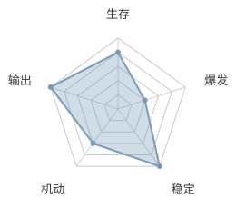

## 分身者(百战)

观众能看见：场上不画本体。四只铁青战影，头顶各自的血。

生命在本体上。开局四只战影，不补。战影按抽到的招一起走。一只战影倒下，本体吃一次折损，剩下的战影回一点血。

## 靶子

观众能看见：蓝色圆球，头顶一只一直说话的伤害气泡。气泡大字是全程 DPS（累计吃到的伤害 ÷ 开局至今），小字是近 5 秒 DPS 和累计伤害。一枪没打也照报 0.0，每 0.2 秒换一次字。

开局血量 99999。挨打照单全收。不出伤，不转向，不改巡航。用来看别的球打得怎样。

## 回声

观众能看见：靛蓝圆球，正面一道闭着的声呐眼；金色星弹从移动方向飞出，撞到墙、人或弹就炸成一圈 16 枚青色声呐碎片；碎片在墙上弹几次才消失。被碎片打中的敌人身上会起一圈青色扫描环，每中一枚补一层，每层 10 秒后自己掉；满 10 层后环变白、回声睁眼，从扫描换成固定 6 秒的突进窗口。期间环保持全满、不再补层或逐层衰减，到期一起清零，再重新积累。层数不显示在通用状态栏，只看这圈环。

声呐读全场，但只把扫满 10 层的敌人当目标。平时朝自己移动的方向放星弹（星弹和碎片完全不出伤，只补扫描）；一旦场上有目标满 10 层，回声不再发星弹，改成穿人冲墙：先站定 0.08 秒锁人，再穿人朝锁定方向直冲到墙，撞到目标就 8 伤；撞墙后重新锁，不限次数；不挂常驻弧；六秒结束时清空标记、退出并把速度重置回巡航，目标没了也退出。

## 内燃机

观众能看见：圆形金属机壳里，四向活塞交替泵动，中央飞轮转动；升档后泵动加快，燃烧室与机壳逐渐由钢灰透出橙红热光，6 档炽热。球外一圈细槽是热力条，双层火焰环与余烬向视野边缘扩散。击破爆发有白热闪光、四向喷焰、冲击波和飞散的金属碎片，随后留下余烟。虚弱时机械停转、火焰熄灭，整球保留暗淡余热。

热力条按时间自涨，满了升档，6 档满则击破。升档只改巡航和视野。普通攻击是自己的节拍；击破后站两秒，第 1 秒打击破伤害。造成的伤害不停帧。

生存 2 · 爆发 4 · 稳定 3 · 机动 3 · 输出 3

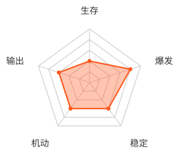

## 钓鱼佬

观众能看见：金黄圆，带暖色光。空军后光偏蓝；高速碰撞时更亮、更饱和。

不转向。开局在可进入区域随机铺三口鱼塘，踩进去站住才钓。空军加快走路巡航。第二次空军清掉还在的开局塘，铺一口盖满场地的鱼塘，之后飞着钓。第三次空军解锁连抽，每竿从 3 到 14 次中等概率选定抽数。够重的鱼先扛着跑，到点再甩出。

一次甩出三条或更多鱼算电鱼。首次电鱼三秒后响警笛，警车从场边开进来，与普通球同大的警察下车，以 50 的速度追钓鱼佬。接触时播放逮捕演出，钓鱼佬直接出局。

生存 3 · 爆发 4 · 稳定 1 · 机动 4 · 输出 3

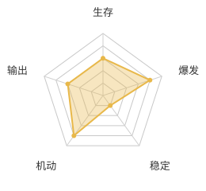

## 藤姬

观众能看见：紫藤色圆球，外圈一层淡紫柔光，身周整圈紫色扇环；藤色在身上时球下方挂一条紫色额外血条，右边数字是还剩多少池子。带藤色的角色身旁别一朵紫藤花标记，数字是层数；幻役是半透明的紫色影子，高速飞行时拖一串残影，掉了藤色就在原地竖起「气绝」两个字散掉。

开局就带一整圈藤弧（1 伤）。开局和之后每 10 秒给己方随机一个角色结付一层「藤色」：每层 10 点额外血条、+1 平加伤害；额外血条还在时挨打整笔被它吃掉，本体不掉血，打穿那一下多出来的伤害直接无视；池子每少 10 点掉一层。同一刻藤色只在一个实体身上，换人接手时剩下的整包搬过去，不是复制。累计结付每满 6 层，在身旁召唤一个幻役（0.1 血），把整包池子搬过去再给它 3 层。幻役穿人（不挡路），出生时朝最近的敌人甩出去，之后直线高速飞、撞墙直接反弹，贴到人打一下（同一个目标 0.6 秒才能再挨）；那一下**只打身上藤色的 +X**，它自己没有任何基础伤害；它只要掉一层就气绝，把整包——按掉之前那几层——还给藤姬。

每 20 秒还能吃一只小东西：身边 240 以内有血量低于 20 的敌方活随从，就当场吞掉它，换一只幻役出来并多喂它一层藤色。场上已经有自己的幻役时不触发——新出来的那只接不到这一包。

藤色落在队友身上时，层数和每层加伤由一只看不见的「看守」记账：它跟着池子走，藤姬倒下也照样一层层掉，池子空了才散。

## 地慧星

观众能看见：天蓝色球，常驻故障切片。居合时球体带短刀光。

身前窄扇环叠剑痕，偶尔留下可穿过的故障残影。受击时若闪避就绪，无效该次攻击并瞬移到离敌人最远的角。撞场边会叠速度。稍后锁定蓄力，打出一条极宽的无限长斩击。

生存 4 · 爆发 5 · 稳定 2 · 机动 4 · 输出 4

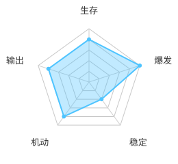

## 教父

观众能看见：深色圆球，细金边。

不转向，自己不出伤。从场边冒出活随从，种类不重复。暗杀者冲刺，狙击者瞄准后开枪，贩卖者丢药然后退场。

## 教父(青年)

观众能看见：比教父浅一号的黑圆，细金边，边上多一圈暗红。球旁是针剂格。

身上三枚针剂，只减不补。近了撞击，远了打手枪。撞击这一段扇环伤害降到四成，别的伤害照吃。花掉针剂就强化一段时间：巡航变快，手枪变多，撞击能把人晕住再折返。

## 反重力猫咪

观众能看见：蓝紫渐变圆球，左上高光、右下青、右上粉，头顶两只猫耳，带辉光。反重力弹是四色四角星，自转。重力脉冲是一大圈旋转的双层环，开时原地炸一把星。

不索敌，不瞄人，自己不出伤；沿场心轨道飞。顺轨道打弹，弹的切向速度故意给少，往场心螺旋掉下去，碰到场心消失；打中按当时的速率算伤，1 到 8，越快越疼。每 20 秒在当前位置开一次重力脉冲，3 秒，半径 420；开了就不跟猫走。圈里自己的弹被收进绕身轨道，到点甩出去，越靠外甩得越快；圈里敌方子弹被抢成自己的弹；别的飞弹和分身被随机拨一个方向，速度不变。猫每拍顺飞行方向补一点速度，轨道不设上限；比当地逃逸还快就不再补。

## 钉与锤

观众能看见：紫色圆球，身外有视野圈。

近战用锤。钉子打中会定人，层数够了爆开。人偶替身把打在它身上的伤转走。

## 勇者

观众能看见：金色圆球。捡到剑之后，球上挂着一把跟着面朝转的剑。

开局不去找装备，四件遗物靠撞上才收。剑是近战，三位同伴跟在后面。史莱姆只咬勇者这一边。杀掉活随从升级，上限和攻击一起涨。

## 原型机_整合

观众能看见青色球心和带窄接缝的橙色切角装甲。开火时，一片装甲剥离成带青色断面的碎块，翻转飞出。球身露出青色缺口，装填期间逐渐补齐。加速时亮起青色喷焰。橙色近身圈和青色反向加速圈都有旋转刻度，敌人跨入时亮起。追踪弧随剩余时间收短，整合弹在追踪期间留下细航迹。

有目标才射击，方向在指向目标的左右各 60° 里摇。人从外圈跨进来可以上追踪。人从内圈外跨进来，自己朝离开的方向加速。

## 小骑士

观众能看见：整体是圆顶封闭式像素钢盔，钢灰轮廓覆盖整个球体，窄目缝中透出暗红底色，短暗红盔缨略超出球体边界；不画面孔或身体。冲起来会留残影。6 秒那档身外有一圈细火环，火往上飘，从空长到满；0.5 秒连冲不画。

开局不满血。身前宽扇环一直挂着。每隔一段时间瞬移到敌人身边再冲撞，有时会立刻再来一次。第一次要死的时候拦下来，锁血十秒。锁血的暗红像素火焰只从目缝向上升，下面甲保持露出。

生存 2 · 爆发 5 · 稳定 4 · 机动 5 · 输出 4

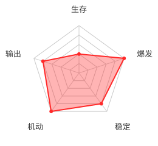

## 蛆

观众能看见：本体不画；粉白蠕虫形蛆宝宝（沿速度蠕动）、头胸腹振翅的苍蝇（白眼可繁殖、红眼冷却）、半透明灰绿卵；三段活随从头顶有生命数字。

本体不出现，生命在本体上，活随从不转伤。开局五只宝宝，成长为苍蝇后互吸叠卵再孵化，苍蝇数量光环磨血。场上无活随从 3 秒则本体扣光。

生存 2 · 爆发 1 · 稳定 2 · 机动 2 · 输出 4

## 迷走

观众能看见：2D 平涂冷青灰圆球；场上六条淡青细环（球下方、场地裁切；外五条锚点沿引导圆转，引导圆跟着心环的圆心，圆心再小抖；整张图随中点平移）；当前所在那条更深青亮盘（环内也铺色）。

不索敌。开局铺心环+轨环；中点以 150 巡游（没有碰撞体，只在场边内缩域里弹），迷走撞墙把中点速度按法线弹回去（0.5 秒一次）；轨环锚点沿看不见的引导圆转，六条圆心相对锚点栓绳抖；人以 221 相对当前环切向走，随圆心完整平移，漂移不抵消或加快绕行；开局及每次换环后须在当前环待满 2 秒，未满时经过交点继续沿当前环走，离轨也纠正回当前环；满 2 秒后交点按现几何、随机改道（不回头），继续留在同一环或反绕不重计时；环上撞墙反绕。点亮亮盘（环上+环内）刮伤 3（0.3s）敌方战斗机与活随从。球自己不出伤。

生存 3 · 爆发 1 · 稳定 2 · 机动 4 · 输出 3

## 原型机_近战

观众能看见：深青机甲装甲、护板与冰青色光学核心；视野圈带分段刻度与从中心向外扩散的青色水波纹，索到目标时亮起冰青色锁定框。加速时尾部推进器增强，并留下冲刺残影。扇环张角会随减伤变宽。整套表现保持青色系。

敌人进入视野边沿就朝对方偏一点，并加速顶上去。身前扇环刮人。挨打时若比巡航快，按超出的速度减伤。

生存 3 · 爆发 2 · 稳定 2 · 机动 5 · 输出 3

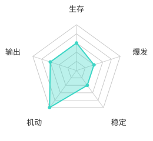

## 面灵气

观众能看见：球色自己在青、红、紫、苍之间转，不改别人颜色。槽位上挂派系图标。身周三张面具顺时针转，图像不跟着转。勾数画在球下方。

开局给自己和敌方每只战斗机各打一个派系。1 勾时异派系加伤、同派系减伤。10 秒后 2 勾，撞墙换派系；敌方每只战斗机各自在补上第四种的那一瞬按这一种结算。再 20 秒 3 勾，倍率加大，凑齐后重新累计。当前派系决定面具伤/体积、射弹、加速或消弹回血。

生存 2 · 爆发 3 · 稳定 2 · 机动 4 · 输出 3

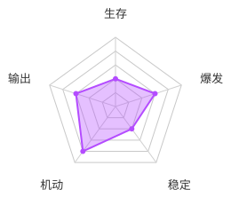

## 我与周旋久

观众能看见：紫色圆球，旁边一只同色的周旋久。

还在无事发生时，和周旋久相撞会互相掉血，并掷出误认、失败或仍是无事发生。周旋久先倒下，或自己挨到致命伤，会按当时的状态变成虚空、神圣、自杀或怪物。胜负仍看这只战斗机。

## 观察者

观众能看见：浅青灰圆球，湿润的灰白眼睑和细血管包住一只竖瞳独眼；瞳孔追着锁定目标，记录和发射时短促收缩。眼下显示观测百分比，复现期间显示剩余发数。左侧最多三张不同色相的弹体胶片，右侧浅青灰特殊胶片显示已归档弹体总发数，包含视线，积累后出现叠片。视线弹沿真实飞行方向绘制；复现弹保持原来那种弹的形状，涂色、公共拖尾和光晕换成这只球的浅青灰。

自己不出普通攻击。最大生命 100。持续观察一个可瞄准的敌人，观测值上限 75，看着目标每秒涨 10，每记下发再加 5，没记下来的第四种不加；附近敌方弹体经过时按发记下。先遇上的三种锁住，同一种继续累加，第四种不记，也不把旧的挤掉。条没满时，条掉光或换了观察对象，记下的都不丢。观测满后按记下的顺序先复现这些，伤害为原来的 85%；没有记录则先打一道视线。然后打特殊胶片里的回响：视线全部保留，不占其余弹体的名额；其余弹体取按打出顺序的前 51%，发数向上取整。选中的回响仍按原来的打出顺序发射。这一轮真正打出去的再写回特殊胶片，视线也算，没飞出去的不算。视线与其余弹体的回响伤害都在打出那一发之上再乘一次 85%。没有可锁定的目标时，还没打出的那一串立刻丢掉。

## 大肥鱼

观众能看见：深蓝圆球，贴着原身立绘，脸朝观众。白饭从七张图里随机抽一张。虎鲸是矢量侧影；潜水时沉下去、变淡，跃起时换成跳跃图，原地闪一下；入水炸两圈水花。

原身不索敌，不转向，不朝白饭走，自己不出伤。白饭撒在可进入区域里，最多五碗，不足每 3 秒补一碗，不撒在她身上；碗不吃伤害，只有原身的圆压得上才吃得掉。原身连续 7 秒没吃上就停在开口那一点喊饭，直到吃上：每 0.5 秒飘一次白色粗体「饭来！」，最近的一碗朝她正弦冲 60、0.4 秒，可以穿墙。吃完回 5 点生命。吃到就变虎鲸 6 秒：半径 34，挨打减半，这几秒不吃白饭。先潜 0.45 秒，再朝跃起那一瞬最近的敌人跃过去，最多 0.5 秒、最远 320，落点钉死在这段距离里，够不着也不闪过去；人走开就打不到；入水时半径 72.8 里敌方战斗机和活随从各吃 9，打中战斗机停一次帧。出水后沿跃的方向滑 1.1 秒，还有时间就再潜一次。6 秒到点变回原身；倒下时剩下的碗一起收掉。

## 老牧师

观众能看见：白圆球，脸正对观众。平时是闭嘴的笑脸，惨叫时换成张嘴。身外最多两圈汉字，各自顺时针转。每一圈出现时在 1.5 到 2.5 秒一圈里抽一次，抽完不变。每个字的底部正对球。

不索敌，不转向，撞墙弹开。球自己不出伤。确认扣了生命才进入惨叫：换脸并出一声，和这一声一样长；这段里再扣血不重开。经文一次喊一句，开局哎呦我去，然后巴哈哈哈哈、我丢雷老某、呦吼吼吼吼。一句喊完，内圈顶到外圈。外圈还在的字先留在原地。下一轮又有字留在原地时，上一轮才朝当时的索敌目标定一次向飞开，之后不改向。没有目标就继续留着。字心到圆心 46、78。每个字伤 2、判定半径 8，不实心。确认扣血后这个字消失并留空。造成的伤害不停帧。倒下那一拍先结算已经重叠上的字，再和两圈一起消失。

生存 3 · 爆发 2 · 稳定 4 · 机动 2 · 输出 2

## 巡回

观众能看见：钢蓝圆球，膛内一枚琥珀色菱形。标识物在外时本体降饱和、菱形变空心缓脉冲——停机等回收。标识物是自旋的琥珀色空心方框，内芯箭头指向飞行方向，飞得越快转得越快、边缘越亮；飞过的轨迹留少量空心方框残影，每层保留当时的角度，再缩小、淡出，四角清晰。暂停时旋转和残影一起停住。

朝随机方向丢出标识物后，只要场上还有当前归属于自己的标识物，自身速度就始终为 0，外部赋速、力和击退均不能使他移动，但墙挤出和瞬移照常；被偷走后再出现也会重新站定，多颗则等最后一颗离场。标识物从静止开始匀加速，4 秒达到约 1428.57 的速率；撞墙按入射角反弹。去程至少飞满 5 秒，窗口内打到人也要收回，但要等满 5 秒后的下一次撞墙才沿去程轨迹倒着飞回，这段穿墙。伤害随撞击时速增长（最低 8、封顶 20），贴在同一个人身上不重复出伤，分开后再撞可以再打，之后继续加速。轨迹走完再飞向主人当前位置。回程没有超时消失的兜底，只有实际回到巡回身边才接回；回不来就一直留在场上。最后一颗离场后恢复 155 巡航，从离场时刻起等 5 秒再丢，锁定期间的赋速和击退不补发；已有眩晕照常结束后再行动。

## 吹笛人

观众能看见：紫色圆球。老鼠从球边跑出去。

自己不出伤。隔一段时间站定吹笛，放出老鼠，场上有上限。老鼠死亡，或贴在敌人身边够久，会叠瘟疫。瘟疫的跳血由吹笛人结算。

## 囚徒

观众能看见：圆球横向黑白条纹相间。钩爪钉上之后，两点之间是一节一节的锈铁链，松弛时挤在弦上，不垂下去弯。

不转向。开局没有钩爪，第一次撞场边才钉；砌在场上的墙不钉。锁链和球体都不出伤。按点落下囚笼、绞刑架、电椅。电流打中锁链则触电，巡航加倍。

生存 3 · 爆发 2 · 稳定 3 · 机动 4 · 输出 3

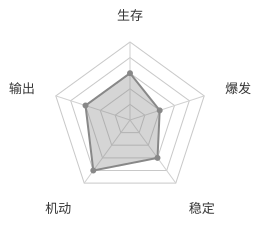

## 雷达

观众能看见：深绿玻璃质感的圆球，内部少量绿色荧光片、细栅格和很淡的扫描纹理，荧光轻微起伏，球外没有仪表标线。一条有清晰亮芯的绿细线从球心伸出，顺时针转，墙处截断并留一点局部绿光；暂停与停帧时装饰动效停住。

不转向，撞墙弹开。激光开局就有、一直转、不灭，碰到墙就截断。扫到敌方战斗机或敌方活随从就结算。朝向不跟速度绑。

生存 2 · 爆发 1 · 稳定 5 · 机动 2 · 输出 4

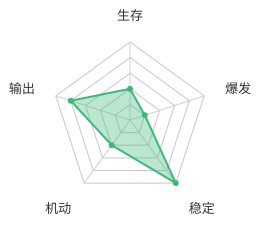

## 雷达(百战)

观众能看见：暗青绿圆球；球外一圈淡青潜水艇雷达标线（十字与同心圆相交）。淡青扫掠线在墙处截断；落弹影渐大，到点琥珀炸开。

不转向，撞墙弹开。没有点名时扫掠线本身不出伤，被墙裁断。点名线上最近的一个人后线消失，先用 1 秒让球壳裂开，再隔 1 秒打一轮，共四轮。打完再用 1 秒收回，扫掠线才回来。

生存 3 · 爆发 2 · 稳定 3 · 机动 2 · 输出 3

## 原型机_远程

观众能看见：简洁的哑光橙色机甲炮台，深橙履带底座上是块面炮塔与长炮管，炮塔独立转动瞄准。开火时炮管后坐再复进，带短促炮口焰和侧面散热亮条；装填时显示一条淡橙细环，装填完便隐藏。瞄准的敌人带淡橙四角准星。打出的弹是同色小火箭，尖头朝前，尾部两片小翼，后面一条尾焰，飞得越快焰越长。

看得见全场。有敌才射。子弹沿开枪方向越飞越快，撞墙弹开后从零再加速，第三次撞墙消失。每开一枪，自己速度反向。

生存 2 · 爆发 2 · 稳定 4 · 机动 3 · 输出 3

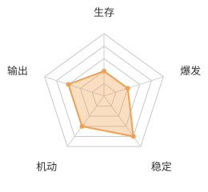

## 收割者

观众能看见：暗紫圆球。钉在场边上的是 2D 描边暗刃、刃口洋红的新月；出过伤之后整把变鲜红。

不转向。撞场边或硬墙钉镰刀，胶囊墙不钉。刀打中不消失。场上到 10 把，这一批放大飞回本体；出过伤的碰到自己回血。

生存 4 · 爆发 3 · 稳定 3 · 机动 2 · 输出 4

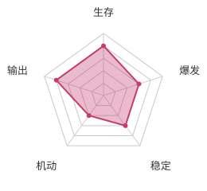

## 中转站

观众能看见：琥珀铜色球壳，下半球沿弧面嵌入端口，上半球是一对上联口，两侧是短散热槽，中央双向箭头表现路由转发；暗铜随从沿用相同布局并减少端口。红绿小状态灯随上线和收发响应。上线时亮起 HELLO 单环，接收时浅金同步环收拢，实际下一跳之间亮起琥珀流动链路。中转弹是闪动的 01 数字，后方拖着逐渐变淡的二进制数字尾迹，数字随飞行保持正向可读。邻居上线、发送、接收和命中各有电子音效，密集收发共用限频。球壳与报文使用原有琥珀、铜棕与浅金色系，红绿仅用于状态灯。

不转向，自己不出伤。开局就留下随从，之后继续留。随从和本体把弹传来传去，打中人仍穿过去。

## 中转站[ospf]

冷青色的中转站沿场边弹行，机身是一台立式机柜：三台 1U 服务器嵌在机壳里，顶上一条琥珀灯带显示发报，底边一条青色灯带显示装机。开局就在出生点安装节点，之后每 2 秒再装一台。发报每 1 秒就绪，朝最近的 ASBR 打出外部路由。还没有 ASBR 时，发报灯带停在满。

白金、蓝、灰、绿节点分别属于骨干 area0、普通 area1、完全 stub area2 和完全 NSSA area3，每台节点是一块 1U 交换机面板。同一个区的节点会连成一片淡色地块，地块上标着区名；同一区里的站间连线是淡色的网线，跨区的上行线偏琥珀色，中转站自己到最近节点的注入线是青色。网线只在骨干圆外绕折，不画曲线。中心更亮的是 DR，外圈带流动虚线的是 ABR。区内报文先到 DR，再按距离逐只传递。跨 area 走 ABR 和最近的 BR。

报文是一格闪烁的 0/1 数据位，颜色是 LSA 类型。报文严格沿画出来的网线飞，拐角处落在折点上再转向；万一脱离网线，模拟会直接 panic 报错。一类和二类留在本 area，三类传递摘要或默认路由，四类通报 ASBR，五类在骨干和普通 area 传递，七类在 NSSA 内传递，带传播标志的七类由 ABR 译成五类。NSSA 的内部 ASBR 不向骨干通告四类。普通 area 的 ABR 收到骨干摘要后，用自己的身份向区内重新发布。新节点从 DR 同步已有公告，历史公告同步时不会变成伤害弹。每发伤 2，穿墙、穿人，也能飞过奇美拉房间之间的场外空隙。重合节点之间瞬间交接。每次接报在节点处引发半径 24 的爆炸，对范围内敌人各造成 2 点伤害。中转站[ospf] 倒下时，自己的节点与报文一起消失。

## R.缪

观众能看见：白圆，和放出去的缪一个样子。

开局放 5 只缪。本体和血最高的那只互换位置和血。缪用近战、子弹和突刺打人。

## 酒翁

观众能看见：沙色圆球。酒坛砸下来，碎处留下一摊酒。

自己不出伤。朝敌人头顶砸酒。酒碰到人、墙或子弹就碎。踩进酒场的人变慢，这一层过一会儿自己掉。他自己的醉意用来决定下一轮砸几坛，不掉。

## 泡泡球

观众能看见：淡青半透明的泡泡球持续吹出大小略有差异、缓慢漂移的泡泡。泡泡吞了子弹后，内部会按弹体颜色和发射者颜色浮出小弹珠；装得越多，泡体越沉、漂得越慢，撞破时弹出的封弹也越多。

泡泡球只按随机方向巡航，不追泡泡也不追敌人。主球会从一根吸管里吹泡泡，每口气持续 1.1～3 秒，这整段就是下一次吹泡的冷却；泡泡在吸管口从小到大长成，完成后才脱离漂走。最终半径在 10～28 之间随机，小泡吹得快、漂得也快，大泡吹得慢、漂得也慢。场上最多同时存在 20 个，每个约活 40 秒；两个泡泡相撞会合并成一颗更大的泡泡，合并后存活时间重新计为 40 秒。泡泡只吞敌方弹体；吞下后弹体消失，泡泡变大减速。主球撞到泡泡不会把它消掉。

敌方战斗机或敌方活随从撞到泡泡时立刻按泡泡体积受到伤害，泡泡随后消失并释放内部封存弹；泡泡越大，这一下越痛，但伤害随半径增长的幅度较低。泡泡最大半径可达 320。装弹泡泡还会逐发向附近敌人释放封弹；装得越多，释放的封弹越多、越快。

## 静电魔球

淡蓝色球身随充能变亮，满 10 层时高频闪烁。每跳放电前，场上会亮起一条位置固定的蓝色预警线。电弧沿线闪过，命中处溅出火花。

移动每秒攒 7.5 点电，撞球、撞墙、挨打也会充能。电荷满 100 后加速找机会开链。开链消耗全部电荷，每跳根据敌人当时的位置和速度定线，预警约 0.34 秒后放电。电弧被墙和场边截断，只打当时与线路接触的第一名敌方战斗机或活随从，打空就断链。

命中后从接触点准备下一跳，优先瞄向射程内另一名敌方战斗机。只有一个目标时，电弧可以回到静电魔球中继，再重新预警。每轮最多三次出伤，依次为 13、10、7。

## 传票员

观众能看见：米色纸球，正面压一枚红章；挨打后原地站住 0.8 秒，再甩出一张纸条。纸条上顶着票面数字飞出去，越飞越慢，最后停在场里等下一个撞上来的人。

不打人，只回信。每次挨打（0.8 秒内置 CD）先站定 0.8 秒，把这一笔伤害记在票上——站着的这 0.8 秒里再挨的打也累加进同一张，出票即清零——然后朝伤害来源甩票；来源已经不在场上（打完就消失的弹、随从）就改甩随机方向。票是匀减速的：初速 420、每秒减 300，1.4 秒后停在 294 px 内。票不是子弹：子弹和碰撞打不掉它、也推不动它；但墙和场边照样挡纸，撞到自己弹回来，不会穿墙、也不会飞出场外。敌方战斗机或活随从的圆心距进到双方半径和以内，按票面金额结算，票随即消失。

每次触发按 70/10/10/10 掷：正常一张；三种故障分别是空窗（一张不出，但不用站、CD 减半到 0.4 秒）、两张、五张，都要喊「发生了一些故障」；两张和五张每张都带同一个票面（就是这一轮累加到的总额）。最近 3 秒内挨得越密，正常那一档越难出（每多挨一下降 5 个点，最低 10%），掉下来的概率平摊给三种故障。

## 外科手术

观众能看见：青绿色圆球，球面保留手术帽帽沿、带褶口罩与手术服接缝，不画人形身体和四肢。手术刀是短刀片与细金属柄，缝线用弧形针牵出黑线；地上切口能看见暗红组织、创缘与湿润高光，闭合后留下交替针眼和缝线。球下暗红条表示大出血进度。

100 血、巡航 170、全场视野。操刀与缝线互斥：先沿自己和当前目标的直线，从敌人方向的场边落刀，拉回固定身前；刀每目标一次伤 8。刀消失后，从最近的开放伤口端点开始沿两侧交替的针眼行进，针每次伤 2，同一目标每条伤口每轮最多三次。缝完全部开放伤口才准备下一刀。

尚未完全缝合的伤口越多，大出血条涨得越快，已缝好的伤口不持续推动进度；全部缝好时保留进度并暂停增长。满值 **200**：持续保有一条开放伤口约 20 秒，三条约 14.3 秒，六条约 10 秒。伤口只要还有没缝的部分，就持续向两侧喷出每发 2 伤的无差别血弹，缝到哪里，哪里停血；满条则把自己已经缝好的伤口重新崩开。缝线状态免疫所有外科手术的血弹，眩晕和击退期间免疫暂时失效，其他伤害照吃。每只最多保留六条，超限最老伤口愈合；倒下后自己的伤口和攻击一起消失。

生存 3 · 爆发 4 · 稳定 3 · 机动 4 · 输出 3

## 太刀

观众能看见：浅色圆球，刃色画在球上。

不追人。人走进身前扇形就挥一刀，这刀不升刃色。每隔一段时间纳刀站定；窗口里挨打就拔刀斩，打中升刃色。挨打太密则后撤再回旋。红刃那一斩打中会登龙，结束落到黄刃。

## 谭泳辰老先生

观众能看见：青色圆球。场上有铃铛和苦无。

开局空手乱飞。自己或同边战斗机撞上铃铛、苦无才算捡到。有苦无才朝人丢苦无。有铃铛时命中够了会净化。命中或暴击够了会开灵狐场域，苦无丢得更快。

## 阈值

观众能看见：黄绿圆球，球心写着当前层数。地上是同色多边形，边线先亮出来，内部在一秒里铺满。

开局 3 层，最大生命 100。挨的一下比层数大，就只吃到层数那么多，多出来的一半加进层数。有敌才在场地里随机画多边形，不跟目标，边数是层数的整数部分，朝向也随机，落下后不再转。层数越高，这只多边形越大：3 层外接圆半径 48，层数翻倍半径翻倍。层数越低画得越密，开局间隔 0.5 秒，层数上去按平方根变长。图形先亮 1 秒，这段不打人。之后再留一阵，3 层留 0.5 秒，层数翻倍多留一倍。留下的时候碰到的敌人各吃一次，伤害等于落笔时的层数。出手后层数减去高出 3 层的那一半。

## 时计

观众能看见：白盘、黑针，开局 0:00。地上的时刻停在刻下时的读数。

开局就在出生点留一个时刻，不占钟点，垫在最底下。场上同时最多七个。每 8 秒时针走两小时。2 点到 12 点的偶数钟点各刻一次，刻过的不再刻。敌人踩进时刻，时计冲过去，并短时间挂上扇环。自己踩进时刻时，从另一个没在静默、离当前索敌目标最近的时刻冲出，落点就是那一档，不闪到敌人身边；冲不到就打不中。自己踩到的这一档不参加挑选，静默中的也不参加。这两档一起静默。没有能选的时刻时，不进入这套冲撞，也不进静默。只有致命伤、而且还有时刻时，才整包拦下并回到上一档。

六个钟点全部刻过、最后一个时刻也用掉或被偷走后，时计进入三秒死亡演出：时针分针反向加速狂转，表盘抖动、泛起过热光晕，随后退场。演出期间不再战斗，暂停时演出也暂停。中途用光但仍有未刻钟点时，保留原来的空走机制。

## 时计·铭刻

观众能看见：和时计同一张白盘——黑刻度、时针分针。分针是抽卡进度（5 点转一圈），时针是时痕层数（每层一小时）。球下方一排五张牌，空位里是同一根进度条；球右下角一个小环，环转满表示下一次命中能抽牌。铭刻与回溯时会在球体上摊开一张半透明表盘（时计场上那张脸的降透明度版），分针把整圈转满：铭刻顺时针，回溯逆时针。

最大生命 60，巡航 165，视野 400。开局手里两张：【铭刻】和牌库里随机抽的一张。每 1 秒攒 1 点，满 5 点从牌库顶抽一张（5 秒一张），手牌没有上限，界面上只画最早的五张。牌库抽空当场重洗成开局那八张。

每 5 秒一个出牌窗口：窗内掷骰决定出 2、3 张，每张都在窗内随机时刻打出，两张至少隔 1 秒。回溯不是抽到就用：【曜时之旅】只在记录里的 buff 掉了之后才打（补层数、补血条），【溯时】只在记录里的手牌比现在多时打，【铭刻】要血量不低于七成上限、手里攒够三张才写。没有记录时两张回溯牌都打不出来，也不占出牌机会。

四张基础牌：时痕（叠一层限时 20 秒的加伤，每层 +3.5，然后冲刺一次）、长守（叠一条限时 20 秒的额外血条，每层 30 点，然后冲刺一次）、曜时之旅（刷新 buff 并回到记录的位置，**一滴血都不回**）、烬时之斩（半径 144 内所有敌人各吃 5 点，然后冲刺一次，再抽走牌库底一张）。

两种 buff 都会自己过期，这是这套牌的核心：回溯的唯一用处就是把它们重新拉满。【曜时之旅】把时痕、长守按记录时的层数重刷成满寿命，并把额外血条补回记录值，再把自身瞬移回记录点；【溯时】只回收手牌（外加抽卡进度与命中抽牌冷却）。血量本身永远只减不增——活命全靠那条额外血条。

【铭刻】记下当场的手牌、抽卡进度、两种 buff 的层数与血条、速度、位置和命中抽牌的冷却，然后自己变成【溯时】沉到牌库底。【溯时】用掉后变回一张【铭刻】回到手里。记录只有一个槽位，后记的覆盖先记的，永远不过期，回溯也不消耗它。

身上常驻一圈包住身体的弧，撞到敌方战斗机或活随从就出 4 点（时痕的 +X 加在这上面），弧随即散掉，0.6 秒后重新长出来。冲刺只负责把人送过去：锁定视野里最近的可瞄准目标，沿直线以 420 冲过去，最多冲 0.6 秒，自己**不结算伤害**。

每 20 秒有一次命中抽牌：冷却好了之后，弧真的贴到人，就抽走牌库底一张，然后重新计时。冷却剩余时间也在【铭刻】的记录里，所以回溯能把冷却倒回去。打到护盾上也算命中。

这套牌没有回血，也没有免费保命：挨的伤害照单全收，能不能活全看长守那条会过期的额外血条。

## 无下限术士

观众能看见：红、蓝两个半圆，中间有连线。红侧像在吸，蓝侧像在推。开局三秒两球头顶交替跳出【九纲】【偏光】【乌与声明】【表里之间】。靠近互吸时场环变成多层收扩同心圆，连线换成多条扭动的紫曲线。相撞时打出的紫弹很大、带拖尾。

开局裂成两半：红吸引、蓝推开，两半身前都挂扇环。开局三秒内两半不会因靠近互吸；三秒后仅一次无视距离互相吸引并撞出紫弹。之后两半靠近时会互相吸引一次，吸完冷却一段时间。红蓝第一次碰到一起时从中点打一发紫弹，中间有挡视线的墙也打。之后再碰到要看得见敌人才打。紫弹穿透敌人可反复结算。

生存 3 · 爆发 4 · 稳定 3 · 机动 3 · 输出 4

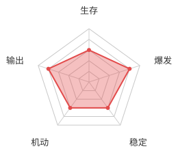

## 人偶使

观众能看见：金黄圆，带光。球外一圈细槽是灵力。人偶是更大的黄球，和本体有白线。

灵力会自己涨，放技能时涨不动。空灵力挨打更痛；前方命中可耗灵力减伤。手里随时准备符卡。人偶打完会收回，待命的人偶能追击或被激光串起来。

生存 3 · 爆发 4 · 稳定 3 · 机动 2 · 输出 4

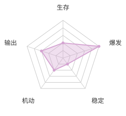

## 筑墙者

观众能看见：土黄色圆球，细边与分层几何刻线，外层刻线缓慢转动。瞄准虚线沿用同色，带两端短刻度，和即将砌出的墙一样长；实际砌墙时短亮，球体刻线同步收拢亮起、向外散出少量同色方片。

按节拍在自己和敌人的中点砌胶囊墙。墙人人弹开，只刮敌方战斗机。自己不会瞬移、不会加速。

生存 4 · 爆发 1 · 稳定 4 · 机动 1 · 输出 2

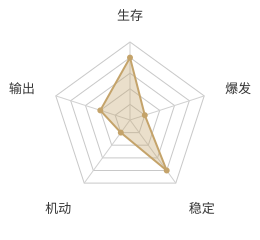

## 筑墙者(百战)

观众能看见：砖色圆球，带一点轻度裂纹。球不换样子。只有前墙、人还在动时，墙身后有很短很稀的砖尘。两堵墙对转时，各有一短截法线标，对准就亮住，先到的等着。冲撞时标收掉，砖尘顺着各自的反方向变密。相撞时大块砖沿冲撞方向向两侧飞开，相撞中心的砖色圆环闪一下。

不转向，球不出伤。先在身前砌前墙，再把第二堵砌在敌人后方。满两堵对转，然后沿法线冲撞。

生存 3 · 爆发 4 · 稳定 3 · 机动 1 · 输出 3

## 盾士

观众能看见：灰蓝重甲圆球，带护甲接缝、铆接与冷白边缘高光。贴身完整盾环由八块拼板组成，接缝不表示耐久；无盾时整圈消失。新盾出现时完整轮廓立即可见，再短促归位、合拢高光。挡伤破盾有近身冷白强闪、盾环崩裂和短扩散弧。灰蓝碎片是较厚的甲片，沿实际飞行方向旋转，带极短拖影；装饰碎屑更细淡。暂停与停帧时装饰动效停住。

盾挡住伤害。盾碎或自己格挡时炸碎片，伴随短促、有分量的金属碎裂声。每 5 秒，或累计挨打够了，再补盾；盾还在时不换。

生存 5 · 爆发 3 · 稳定 4 · 机动 2 · 输出 2

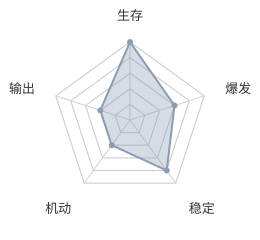

## 狼人

观众能看见：骨白圆球，尖耳长在上沿，鬃毛从外轮廓伸出，前侧露着一对獠牙，身前是三道带尖锋的爪痕扇环。可进入区域里有一颗浅金月亮，月面有陨坑与明暗月相，满月微微发亮。撕咬时毛边泛红、鬃毛立起，前侧獠牙张开再收咬，扇环换成带六枚獠牙的淡红撕咬弧。

开局在可进入区域随机挂月亮，不与墙重叠。自己、敌方战斗机或敌方活随从进入月亮，推进月相。连续 10 秒没有推进时，狼人站定 1 秒，头顶飘「嗷唔」，然后自己给月亮加一格。满月进入撕咬，持续 8 秒，这整段一直穿人，打到人也不收回，撕咬结束才收回。站 0.3 秒看人，再以 640 冲 180，走满或撞墙只结束这一段，时间没到就再看再冲。8 秒在站着时到了就收；正在冲则这段走完或撞墙再收。平时身前扇环。撕咬里不挂这道扇环，每次冲刺只生成一道撕咬弧，这段冲完就摘掉。撕咬伤害从 6 起，每咬中 2 次加 1，没凑满的一次和伤害都留到下一轮。冲刺的那段里，打在狼人身上的扇环伤害减到四成。

生存 3 · 爆发 5 · 稳定 2 · 机动 5 · 输出 4

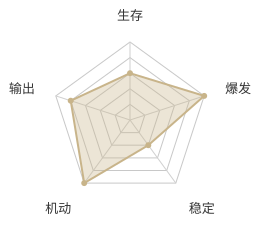

## 小幺哥

观众能看见：珊瑚红色的礼物包装球，金色十字缎带和蝴蝶结压在球面上，正面有小眼睛和笑嘴。丢礼物时整颗球会向投掷方向压一下；礼物盒是红底金缎带的小盒子，飞在空中会旋转抖动，开后盒盖弹飞并炸出一圈彩纸和帮手名字。

小幺哥最大生命 80，巡航 152，视野 9999。它只随机巡航和换向；开局约 1 秒后向当前索敌方向丢出唯一的礼物盒，整局不再召唤第二个。礼物盒飞行约 0.9 秒，或撞墙时立即打开，从全部可选战斗机中随机选出一只登场帮他。随机名单不会出现小幺哥和靶子。

随机帮手是完整的临时战斗机，按该角色的原始外观、属性和行为参战，但只持续到被打倒或小幺哥倒下，并且不计入胜负。小幺哥自己倒下时直接判负，即使帮手还活着也一样。

## 闪烁

观众能看见浅金属绿圆球、横向发光目镜和贴身的细虹环。侧闪时虹环收紧，朝威胁方向亮弧，沿实际路径留下青绿、淡紫的轮廓残像。虹环在冷却期间逐渐恢复，全部表现随对局时间暂停。

视野 9999。预判飞弹、扇环和已知危险范围的命中。侧闪在攻击轴的两侧法线中选安全路线。飞弹与冲刺用来向，光束和墙用轴线，无攻击轴的区域伤用进入方向。两侧都躲不开时保留侧闪。每段侧闪速率 720、距离 24，约 0.033 秒。飞弹通常看未来 0.15 秒，炮击等已公布的生效时刻可看得更早。场地伤也能触发侧闪。

侧闪途中持续预判剩余路线，预计继续走会中招且有安全法线时立即接下一段。接闪可以连续发生，冷却 0.25 秒从最后一段发动起算。整串侧闪在收招时结算残像。

侧闪期间实际命中的伤害照常结算。侧闪穿过单位，撞墙沿反弹方向收招。击退期间由外力接管，侧闪计时照走，击退结束后恢复巡航 170。眩晕可以取消起步或提前结束侧闪，冷却继续走。

每 0.9 秒按通常索敌向 280 范围内的目标打出一发 2 伤折线弹，侧闪途中也能照常开火。折线弹先斜着飞 0.1 秒，再根据目标当时的位置和速度折向一次。此后沿直线飞行。

侧闪收招位置距第一段起点至少 8 时，会在起点留下一个夹射残像，至多保留 0.9 秒。下一次普攻消耗残像，本体和残像从两处各发一弹，先各自向外展开，再折向同一目标。新的残像覆盖旧的，残像被墙占住时只由本体发射。

每段侧闪结束时可回击一发 1 伤智能弹，接下一段时结算前一段，优先瞄准该段的威胁来源。来源不可瞄准时按通常索敌。眩晕打断侧闪时取消当前段的反击。

射弹速率 464、半径 3、寿命 1 秒，命中不停帧。智能弹最大转向速率 2.4 弧度/秒，目标失效、被挡视线或已飞过目标后沿当前方向继续飞。射弹撞墙或撞到单位即消失，实际命中敌方战斗机或活随从才出伤。
